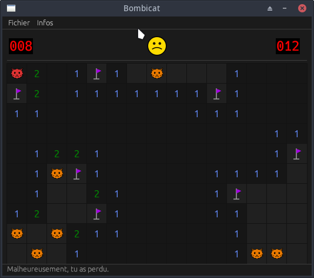

# Bombicat

[](https://github.com/Antidote1911/bombicat/releases/latest)
[](https://github.com/Antidote1911/bombicat/actions/workflows/release.yml)
[](https://www.rust-lang.org)
[](LICENSE)



A minesweeper with cats, written in Rust with [egui](https://github.com/emilk/egui).

[Lire en français](README_fr.md)

## Features

- **6 difficulty levels** — from Beginner to Chuck Norris
- **No-guess generation** — every grid is guaranteed solvable by pure logic, no guessing required
- **Advanced deductions (optional)** — grids that still never require guessing, but sometimes ask you to work through every possible case in an area
- **High scores** — top 10 times per level, to the tenth of a second, stored locally in SQLite
- **Pause** — timer stopped and grid hidden
- **French / English** — follows the system language, can be changed in the preferences
- **Hint** — `Ctrl+H` points at a cell that can actually be deduced (the game then no longer counts for high scores)
- **Resizable window** — cell size follows the window size
- **Dark UI** — fully vector-rendered via egui

## Controls

| Action | Input |
|---|---|
| Reveal a cell | Left click (on release, on the cell under the pointer) |
| Place / remove a flag / `?` | Right click (cycles: none → flag → `?`) |
| Reveal the neighbours of a number whose flags are placed | Left click on the number, middle click, or left + right |
| Hint | `Ctrl+H` |
| Pause | `P` |
| New game | Smiley button or `Ctrl+N` |

## Levels

| Level | Grid | Cats |
|---|---|---|
| Beginner | 15 × 10 | 15 |
| Normal | 20 × 15 | 40 |
| Hard | 25 × 15 | 62 |
| Very Hard | 27 × 20 | 120 |
| Giant | 35 × 22 | 190 |
| Chuck Norris | 40 × 25 | 250 |

## Building and running

Prerequisite: [Rust](https://rustup.rs/) (edition 2021 or later)

```bash
cargo run --release
```

### Cheat mode

The `--cheat` flag turns middle-click into "reveal the entire grid" (the game then no longer counts for high scores):

```bash
cargo run --release -- --cheat
```

### Tests

```bash
cargo test --release
```

## No-guess algorithm

On each new game, the first click triggers grid generation in a background thread. The generator produces a random cat placement and feeds it to a logic solver that simulates what a player can deduce:

- **Local constraint**: if the number of hidden cells around a number equals its remaining cat count → all of them are cats (auto-flagged)
- **Local constraint**: if all neighbouring cats are already flagged → remaining hidden neighbours are safe (auto-revealed)
- **Constraint pairs**: for two nearby numbers A and B, if the difference of their remaining cats equals the number of cells only A touches → those cells are cats and the cells only B touches are safe
- **Global constraint**: if total remaining cats equals total hidden cells → all are cats; if zero cats remain → all are safe

The clicked cell and its 8 neighbours are always guaranteed cat-free. If the solver can reveal the entire grid without ever guessing, the layout is accepted. Otherwise the generator does not throw the grid away: it reshuffles the cats of a small square around the place where the solver got stuck, and keeps the change if the solver gets at least as far. After a few unsuccessful changes it starts again from a fresh grid, so that grids stay close to a random draw. A Chuck Norris grid thus takes about 150 attempts (45 ms on a single core) instead of about 10,000. Starting a new game cancels a generation in progress.

With the "advanced deductions" option, the solver additionally works through every possible placement on each area of the frontier when the rules above are not enough.

Details of the optimisations and before/after measurements are in [OPTIMISATION.txt](OPTIMISATION.txt) (in French).

## Project structure

```
src/
  main.rs      — entry point, window setup
  app.rs       — UI logic (egui), click handling and modals
  model.rs     — game model, cat placement, no-guess solver
  scores.rs    — score persistence (SQLite via rusqlite)
  settings.rs  — user preferences (level, language, options)
assets/
  images/
    cat.svg           — cat icon (mine)
    disarmed_red.png  — misplaced flag (revealed at game over)
    question.png      — question mark marker
```

## Persistent data

Data files are stored in standard system directories:

- **Config**: `$XDG_CONFIG_HOME/bombicat/config.json` (Linux) / `~/Library/Application Support/bombicat/config.json` (macOS) / `%APPDATA%\bombicat\config.json` (Windows)
- **Scores**: `$XDG_DATA_HOME/bombicat/scores.sqlite`

## License

[GNU General Public License v3.0](LICENSE)
