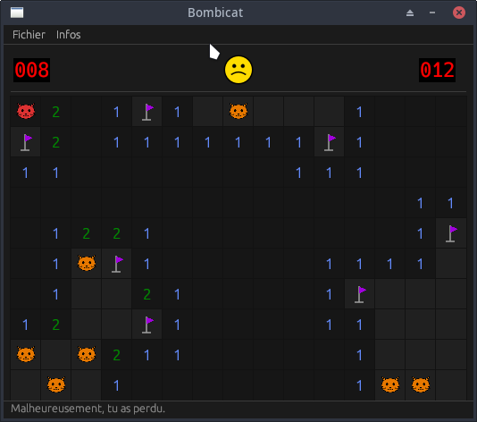

# Bombicat

[](https://github.com/Antidote1911/bombicat/releases/latest)
[](https://github.com/Antidote1911/bombicat/actions/workflows/release.yml)
[](https://www.rust-lang.org)
[](LICENSE)



Un démineur avec des chats, écrit en Rust avec [egui](https://github.com/emilk/egui).

[Read in English](README.md)

## Fonctionnalités

- **6 niveaux de difficulté** — de Débutant à Chuck Norris
- **Génération sans hasard (no-guess)** — chaque grille est garantie résolvable par déduction pure, sans jamais avoir à deviner
- **Déductions avancées (option)** — des grilles toujours sans hasard, mais qui demandent parfois d'étudier tous les cas possibles sur une zone
- **Meilleurs scores** — classement des 10 meilleurs temps par niveau, au dixième de seconde, stocké localement en SQLite
- **Pause** — chronomètre arrêté et grille masquée
- **Français / anglais** — suit la langue du système, modifiable dans les préférences
- **Aide** — `Ctrl+H` désigne une case qu'on peut réellement déduire (la partie ne compte alors plus pour les scores)
- **Fenêtre redimensionnable** — la taille des cases suit celle de la fenêtre
- **Interface sombre** — rendu entièrement vectoriel via egui

## Contrôles

| Action | Commande |
|---|---|
| Découvrir une case | Clic gauche (au relâchement, sur la case sous la souris) |
| Poser / retirer un drapeau / `?` | Clic droit (cycle : aucun → drapeau → `?`) |
| Découvrir les voisines d'un chiffre dont les drapeaux sont posés | Clic gauche sur le chiffre, clic milieu, ou gauche + droit |
| Aide | `Ctrl+H` |
| Pause | `P` |
| Nouvelle partie | Bouton smiley ou `Ctrl+N` |

## Niveaux

| Niveau | Grille | Chats |
|---|---|---|
| Débutant | 15 × 10 | 15 |
| Normal | 20 × 15 | 40 |
| Difficile | 25 × 15 | 62 |
| Ultra Difficile | 27 × 20 | 120 |
| Géant | 35 × 22 | 190 |
| Chuck Norris | 40 × 25 | 250 |

## Compilation et lancement

Prérequis : [Rust](https://rustup.rs/) (édition 2021 ou supérieure)

```bash
cargo run --release
```

### Mode triche

Le flag `--cheat` fait du clic milieu une révélation de toute la grille (la partie ne compte plus pour les scores) :

```bash
cargo run --release -- --cheat
```

### Tests

```bash
cargo test --release
```

## Algorithme no-guess

À chaque nouvelle partie, le premier clic déclenche la génération en arrière-plan. Le générateur produit un placement aléatoire et le soumet à un solveur logique qui simule ce qu'un joueur peut déduire :

- **Contrainte locale** : si le nombre de cases cachées autour d'un chiffre est égal au nombre de chats restants à trouver → toutes sont des chats (flaggage automatique)
- **Contrainte locale** : si tous les chats voisins sont déjà flaggés → les cases cachées restantes sont sûres (révélation automatique)
- **Paires de contraintes** : pour deux chiffres proches A et B, si la différence de leurs chats restants égale le nombre de cases propres à A → ces cases sont des chats et les cases propres à B sont sûres
- **Contrainte globale** : si le total de chats restants égale le total de cases cachées → toutes sont des chats ; si zéro chat restant → toutes sont sûres

La case cliquée et ses 8 voisines sont toujours garanties sans chat. Si le solveur arrive à révéler toute la grille sans jamais devoir deviner, la disposition est acceptée. Sinon, le générateur ne jette pas la grille : il redistribue au hasard les chats d'un petit carré autour du point de blocage, et garde la retouche si le solveur va au moins aussi loin. Une grille Chuck Norris demande ainsi une trentaine d'essais (environ 12 ms sur un seul cœur) au lieu d'environ 10 000. Lancer une nouvelle partie annule la génération en cours.

Avec l'option « déductions avancées », le solveur étudie en plus tous les placements possibles sur chaque zone de la frontière quand les règles ci-dessus ne suffisent pas.

Le détail des optimisations et les mesures avant/après sont dans [OPTIMISATION.txt](OPTIMISATION.txt).

## Structure du projet

```
src/
  main.rs      — point d'entrée, configuration de la fenêtre
  app.rs       — logique d'interface (egui), gestion des clics et modales
  model.rs     — modèle de jeu, placement des chats, solveur no-guess
  scores.rs    — persistance des scores (SQLite via rusqlite)
  settings.rs  — préférences utilisateur (niveau, langue, options)
assets/
  images/
    cat.svg           — icône chat (mine)
    disarmed_red.png  — drapeau mal placé (révélé en fin de partie)
    question.png      — marqueur point d'interrogation
```

## Données persistantes

Les fichiers de données sont stockés dans les dossiers standard du système :

- **Config** : `$XDG_CONFIG_HOME/bombicat/config.json` (Linux) / `~/Library/Application Support/bombicat/config.json` (macOS) / `%APPDATA%\bombicat\config.json` (Windows)
- **Scores** : `$XDG_DATA_HOME/bombicat/scores.sqlite` — chaque score garde les règles avec lesquelles il a été obtenu (taille, nombre de chats, déductions avancées) ; les scores obtenus avec d'autres règles restent affichés, à part

## Licence

[GNU General Public License v3.0](LICENSE)
